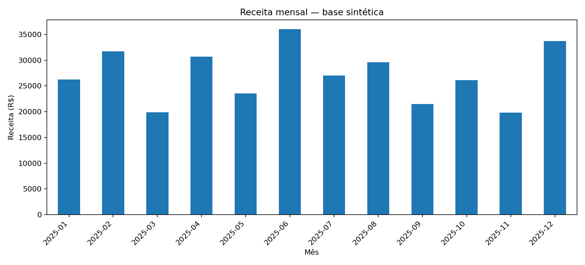
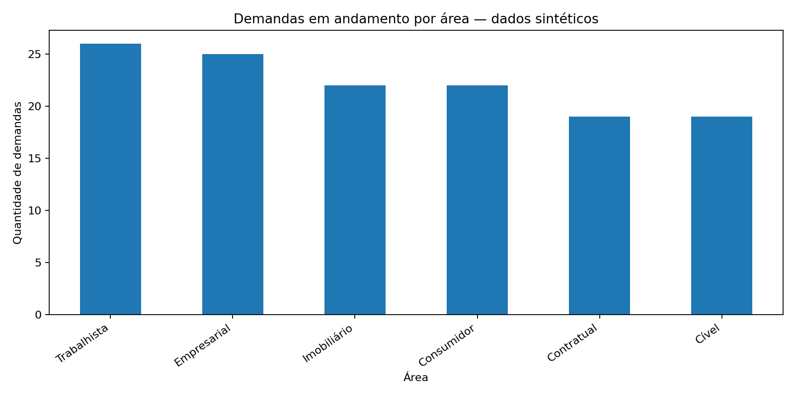

# Thiago Rodrigues

  <strong>Business Analysis · Análise de Processos · Data Analytics em formação · Legal Tech</strong> 
  Experiência em negócios e operações, com desenvolvimento contínuo de competências em dados e tecnologia.

  
  
  
  
  
  

## Apresentação

Sou formado em **Administração** e **Direito**, com experiência no setor jurídico desde 2007 e trajetória anterior em gestão de operações e rotinas administrativas. Minha experiência envolve análise de informações, investigação documental, gestão de processos, contratos, prevenção de riscos, conformidade, negociação e resolução estruturada de problemas.

Atualmente, desenvolvo competências em **Business Analysis, análise de processos e Data Analytics** por meio da Carreira Tech – Trilha Análise de Dados (SCTEC/SENAI).

## Foco profissional

- Business Analysis e análise de requisitos
- Análise, documentação e melhoria de processos
- Data Analytics e qualidade da informação
- Legal Operations, Legal Tech e operações jurídicas
- Gestão documental, contratos, riscos e conformidade

## Tecnologias em desenvolvimento

| Área | Conhecimentos | Nível apresentado |
|---|---|---|
| Programação | Python, Java | Fundamentos / em formação |
| Análise de dados | Pandas, NumPy, Matplotlib | Em formação |
| Banco relacional | SQL, PostgreSQL | Fundamentos |
| Banco NoSQL | MongoDB, conceitos NoSQL | Fundamentos |

**Formação atual:** Carreira Tech – Trilha Análise de Dados, SCTEC/SENAI. A etapa de Manipulação de Dados com Python e SQL está prevista até 11/12/2026; a etapa de Gestão de Dados com Arquitetura Moderna está programada para 25/01 a 28/05/2027.

## Projetos em destaque

### 01 · Análise de Varejo com Python e SQL

Estudo de análise exploratória com 600 registros sintéticos de vendas. Inclui validação e tratamento de dados, métricas de receita, custo e margem, análises por mês/categoria/canal/região, consultas SQL e gráfico de receita mensal.

- [Documentação do projeto](projects/01-analise-varejo-python-sql/README.md)
- [Código Python](projects/01-analise-varejo-python-sql/src/analise_vendas.py)
- [Consultas SQL](projects/01-analise-varejo-python-sql/sql/consultas.sql)
- [Base sintética CSV](projects/01-analise-varejo-python-sql/data/vendas_sinteticas.csv)

### 02 · Legal Operations Analytics

Estudo de indicadores operacionais com 180 registros jurídicos inteiramente fictícios. Demonstra análise de demandas em andamento, distribuição por área e etapa, valores referenciais, SQL e exemplos de documentos/consultas MongoDB.

- [Documentação do projeto](projects/02-legal-operations-analytics/README.md)
- [Código Python](projects/02-legal-operations-analytics/src/analise_legal_ops.py)
- [Consultas SQL](projects/02-legal-operations-analytics/sql/consultas.sql)
- [Exemplos MongoDB](projects/02-legal-operations-analytics/mongodb/)

### 03 · Business Analysis — Mapeamento de Processos

Estudo de um processo fictício de recebimento e triagem de demandas, documentado com contexto do problema, stakeholders, visão AS-IS/TO-BE, requisitos funcionais e não funcionais, user stories, critérios de aceite e fluxo Mermaid.

- [Documentação do projeto](projects/03-business-analysis-processos/README.md)
- [Contexto e problema](projects/03-business-analysis-processos/01-contexto-e-problema.md)
- [Mapeamento AS-IS / TO-BE](projects/03-business-analysis-processos/02-as-is-to-be.md)
- [Requisitos](projects/03-business-analysis-processos/03-requisitos.md)
- [Histórias de usuário](projects/03-business-analysis-processos/04-user-stories.md)

## Formação acadêmica e tecnológica

- Bacharelado em Administração — UNIVILLE
- Bacharelado em Direito — FCJ
- Carreira Tech – Trilha Análise de Dados — SCTEC/SENAI (em andamento)

## Portfólio e contato

- **LinkedIn:** [linkedin.com/in/thiago-rodrigues-2112188b](https://www.linkedin.com/in/thiago-rodrigues-2112188b)
- **GitHub:** [github.com/RodriguesProject](https://github.com/RodriguesProject)
- **Localização:** Joinville, Santa Catarina, Brasil
- **Interesse:** oportunidades remotas no Brasil e posições híbridas/presenciais em Joinville e região.

---

> **Transparência:** os projetos deste repositório são estudos demonstrativos. Os conjuntos de dados foram gerados artificialmente e não representam clientes, processos, empresas ou resultados reais. As tecnologias são apresentadas conforme o nível de formação declarado; não são descritas como experiência profissional avançada.
