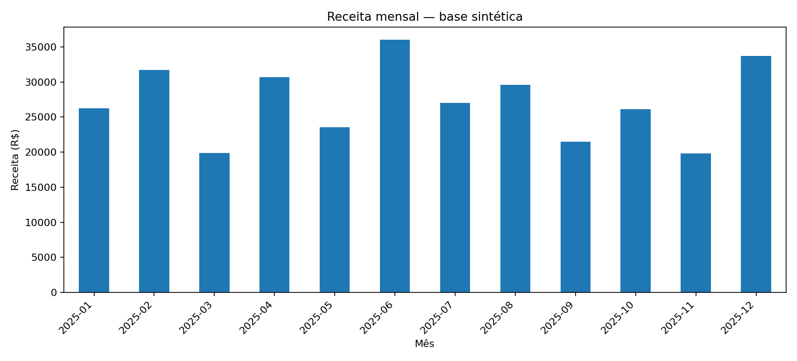

# Projeto 01 — Análise de Varejo com Python e SQL

**Objetivo:** demonstrar um fluxo introdutório de análise de dados, da leitura e validação de uma base à geração de indicadores e consultas SQL.



## Perguntas de negócio
1. Qual foi a receita, o custo estimado e a margem bruta por mês?
2. Quais categorias geraram maior receita?
3. Como os canais de venda se comparam?
4. Quais regiões concentram as vendas?

## Tecnologias
Python, Pandas, Matplotlib, PostgreSQL e SQL.

## Dados
`data/vendas_sinteticas.csv` contém 600 registros artificiais. Não são dados de clientes ou empresas reais.

## Como executar
```bash
python -m venv .venv
# Windows PowerShell: .venv\Scripts\Activate.ps1
# Linux/macOS: source .venv/bin/activate
pip install -r requirements.txt
python src/analise_vendas.py
```

## Estrutura
- `data/`: base sintética.
- `src/analise_vendas.py`: validação, métricas e visualização.
- `sql/schema.sql`: estrutura PostgreSQL.
- `sql/consultas.sql`: consultas analíticas.
- `outputs/`: relatórios e gráfico.

## Consultas SQL adicionais
O arquivo de consultas inclui funções de janela (`LAG`, `ROW_NUMBER`), variação mensal e identificação do produto de maior receita por categoria.

## Limitações
Exercício com dados artificiais. Não contempla impostos, devoluções, frete, descontos complexos ou sazonalidade validada. Indicadores didáticos, sem uso comercial.

## Kit Power BI

O diretório `powerbi/` contém um guia para montar o dashboard no Power BI Desktop, medidas DAX, calendário e tema visual. A entrega inclui recursos de preparação, não um arquivo `.pbix` pronto.

- [Guia de montagem do painel](powerbi/README.md)
- [Medidas DAX](powerbi/MEDIDAS.dax)
- [Tabela calendário](powerbi/CALENDARIO.dax)
- [Tema visual](powerbi/TEMA_RODRIGUES.json)
