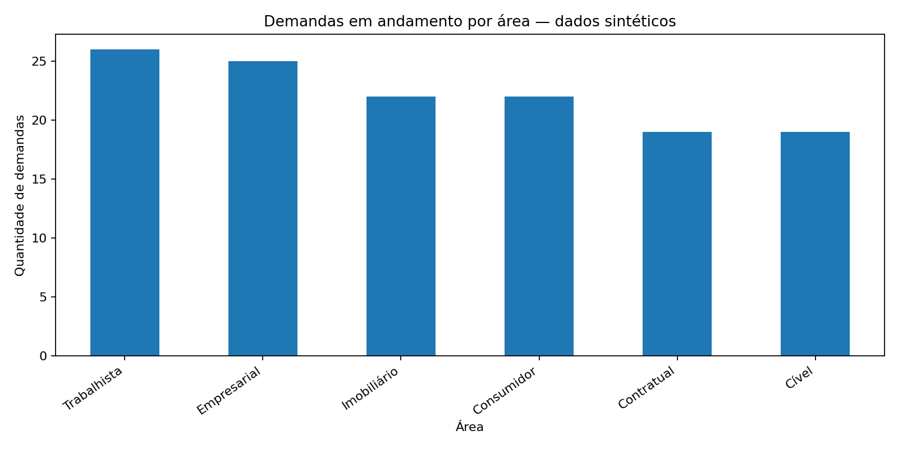

# Projeto 02 — Legal Operations Analytics

**Objetivo:** demonstrar como dados operacionais podem apoiar o acompanhamento de uma carteira fictícia de demandas jurídicas.



## Perguntas de negócio
- Quantas demandas estão em andamento?
- Quantas têm prazo de referência vencido na data-base?
- Como se distribuem por área, etapa e responsável?
- Qual o valor referencial agregado da carteira aberta?
- Qual a antiguidade média das demandas em andamento?

## Tecnologias
Python, Pandas, Matplotlib, PostgreSQL/SQL e exemplos introdutórios de MongoDB.

## Dados e privacidade
`data/demandas_sinteticas.csv` contém 180 registros artificiais. A data-base é 13/11/2026. Não há dados de clientes ou processos reais.

## Execução
```bash
python -m venv .venv
# Windows PowerShell: .venv\Scripts\Activate.ps1
# Linux/macOS: source .venv/bin/activate
pip install -r requirements.txt
python src/analise_legal_ops.py
```

## Estrutura
- `data/`: base sintética.
- `src/`: validação e indicadores.
- `sql/`: schema e consultas PostgreSQL.
- `mongodb/`: exemplo de documento e consultas NoSQL.
- `outputs/`: relatórios e gráfico.

## Consultas adicionais
Inclui análise de carga por responsável e faixas de antiguidade, além de contagem condicional e agregações.

## Limitações
O campo `prazo_referencia` é um atributo fictício para análise de dados. Não representa prazo processual calculado conforme lei, intimação, suspensão ou calendário forense. O projeto não recomenda decisões sobre processos reais.
